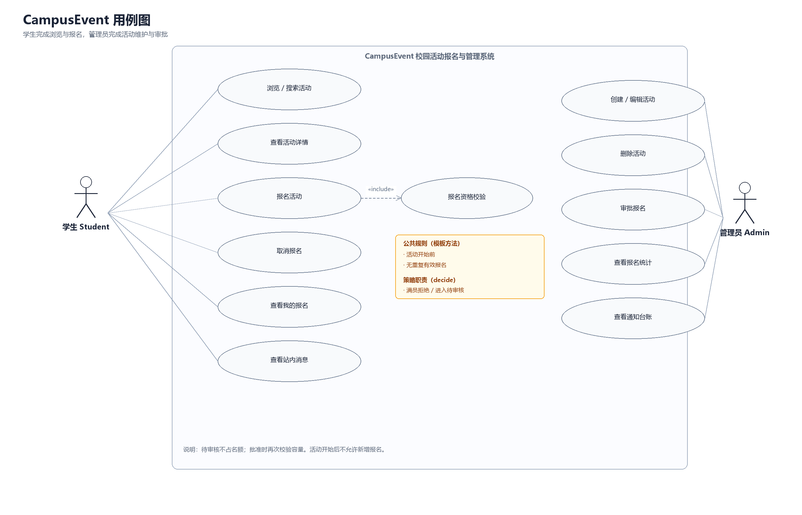

# 用例说明（baseline-v1）

## UC-01 浏览与搜索活动

| 项 | 内容 |
| --- | --- |
| 参与者 | 学生、管理员 |
| 前置条件 | 已使用固定演示账号登录 |
| 触发 | 打开“活动广场”或输入关键词搜索 |
| 主流程 | 1. 系统按开始时间升序查询活动；2. 对每个活动聚合已通过/待审核人数与剩余名额；3. 学生看到自己最近一条报名状态；4. 输入名称关键词时按标题模糊匹配并刷新列表 |
| 异常流程 | 1a. 未登录：跳转登录页并提示；2a. 无匹配结果：显示空状态与清除筛选入口 |
| 后置条件 | 无数据变更 |
| 关联需求 | P2-F02、P2-F08 |

## UC-02 查看活动详情与统计

| 项 | 内容 |
| --- | --- |
| 参与者 | 学生、管理员 |
| 前置条件 | 活动存在 |
| 主流程 | 1. 系统展示活动名称、类型、时间、地点、人数上限、报名方式、说明；2. 展示已通过数、待审核数、剩余名额；3. 学生看到自己的报名状态与可执行操作；4. 管理员看到全部报名记录与审批入口 |
| 异常流程 | 1a. 活动不存在：提示“活动不存在或已被删除”并返回列表 |
| 后置条件 | 无数据变更 |
| 关联需求 | P2-F02、P2-F08 |

## UC-03 报名活动

| 项 | 内容 |
| --- | --- |
| 参与者 | 学生 |
| 前置条件 | 已登录且不是管理员；活动存在且尚未开始 |
| 触发 | 点击“立即报名”或“申请报名（需审核）” |
| 主流程 | 1. 系统读取活动、学生、该学生的有效报名与已通过人数；2. 根据活动 `policy_type` 从注册表选择策略；3. 策略模板方法校验公共规则（活动未开始、无重复有效报名）；4. 策略 `decide` 判定：直接报名在有名额时返回“已通过”，审核报名返回“待审核”；5. 系统在写事务内插入报名记录；6. 提交事务后发布报名事件；7. 站内消息与邮件订阅者分别投递；8. 跳转详情页并提示当前状态 |
| 异常流程 | 3a. 活动已开始：拒绝，提示“活动已开始，不能再报名”；3b. 已有待审核/已通过报名：拒绝并提示；4a. 直接报名满员：拒绝并提示剩余 0；5a. 并发唯一索引冲突：回滚并提示重复报名；7a. 邮件失败：报名仍有效，失败写入投递台账 |
| 后置条件 | 新增一条报名（approved 或 pending），产生两条通知投递记录（成功或失败） |
| 关联需求 | P2-F03、P2-F04、P2-F07；用例 C2、C3、C4、C5 |

## UC-04 取消报名

| 项 | 内容 |
| --- | --- |
| 参与者 | 学生（管理员可代为取消已通过报名） |
| 前置条件 | 报名存在且状态为待审核或已通过 |
| 主流程 | 1. 校验操作者身份（本人或管理员）；2. 校验状态允许取消；3. 更新为“已取消”并记录原因；4. 发布取消事件；5. 通知学生；6. 统计中的已通过数减少、剩余名额增加 |
| 异常流程 | 1a. 取消他人报名且非管理员：拒绝；2a. 已拒绝/已取消：提示当前状态不能取消 |
| 后置条件 | 报名保留为历史记录，状态为 cancelled；名额释放 |
| 关联需求 | P2-F03、P2-F06；用例 C9 |

## UC-05 审批报名

| 项 | 内容 |
| --- | --- |
| 参与者 | 管理员 |
| 前置条件 | 存在待审核报名；操作者为管理员 |
| 触发 | 在审批台点击“批准”或“拒绝” |
| 主流程 | 1. 读取报名、活动、学生；2. 校验报名状态为待审核；3. 批准时在写事务内重新统计已通过人数；4. 未满员则更新为“已通过”，满员则拒绝操作；5. 提交事务后发布“报名通过/被拒绝”事件；6. 通知学生 |
| 异常流程 | 2a. 状态不是待审核：提示不能审批；3a. 已通过数 ≥ 容量：提示“名额已满”，状态保持待审核，不超员 |
| 后置条件 | 报名状态变为 approved 或 rejected；产生通知 |
| 关联需求 | P2-F05、P2-F06、P2-F07；用例 C6、C7、C8 |

## UC-06 维护活动

| 项 | 内容 |
| --- | --- |
| 参与者 | 管理员 |
| 前置条件 | 操作者为管理员 |
| 主流程 | 1. 填写名称、类型、时间、地点、人数上限、报名方式、描述；2. 系统校验字段长度、容量范围、时间格式与未来时间；3. 保存并刷新列表/详情 |
| 异常流程 | 2a. 字段非法：返回表单并提示具体原因，不落库；2b. 修改容量小于已通过人数：拒绝；2c. 活动已有报名时修改报名方式：拒绝；2d. 删除有报名的活动：拒绝并提示 |
| 后置条件 | 活动新增/更新；无报名时才允许删除 |
| 关联需求 | P2-F01；用例 C1 |

## UC-07 查看通知

| 项 | 内容 |
| --- | --- |
| 参与者 | 学生、管理员 |
| 主流程 | 1. 学生打开“站内消息”，按时间倒序查看，可全部标为已读；2. 管理员打开“通知台账”，查看每个事件的渠道、状态与错误，以及邮件出件箱 |
| 异常流程 | 1a. 学生无消息：显示空状态；2a. 管理员访问学生消息页：引导到通知台账 |
| 关联需求 | P2-F07；通知测试 |

## 用例与业务规则对照

| 规则 | UC-03 | UC-04 | UC-05 | UC-06 |
| --- | --- | --- | --- | --- |
| 名额只算已通过 | ✔ | ✔（释放） | ✔（再次检查） | ✔（容量下限校验） |
| 无重复有效报名 | ✔ | — | — | — |
| 活动开始后禁止新增 | ✔ | 允许取消 | — | — |
| 通知与业务解耦 | ✔ | ✔ | ✔ | — |
| 删除保护 | — | — | — | ✔ |
