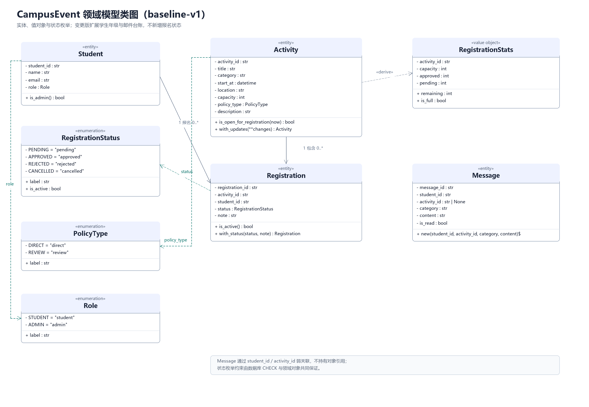

# UML 类图与职责划分（baseline-v1）

类图分为两个视图：**领域模型视图**回答“系统有哪些业务概念、它们如何关联”；**设计类图视图**回答“职责如何分配到类/接口、变化点被隔离在哪里”。两张图共同覆盖指导书 B.3 的检查要求。

## 1. 领域模型类图



### 1.1 实体与值对象

| 对象 | 类型 | 主要字段 | 约束/不变量 |
| --- | --- | --- | --- |
| Student | 实体 | student_id、name、email、role | student_id 唯一；role 限 student/admin |
| Activity | 实体 | activity_id、title、category、start_at、location、capacity、policy_type | capacity 1—500；开始前才可报名 |
| Registration | 实体 | registration_id、activity_id、student_id、status、note | 状态限四值；同一学生同一活动最多一条 pending/approved |
| Message | 实体 | message_id、student_id、activity_id、category、content、is_read | 站内消息按学生查询；activity_id 允许为空 |
| RegistrationStats | 值对象 | capacity、approved、pending | remaining = max(capacity-approved, 0)；is_full |
| RegistrationStatus / PolicyType / Role | 枚举 | 固定取值 | 与数据库 CHECK 约束一致 |

### 1.2 关系与数量

- `Student 1 — 0..* Registration`：一个学生可有多条报名，分属不同活动；同一活动最多一条有效报名（由部分唯一索引约束）。
- `Activity 1 — 0..* Registration`：活动包含报名；删除活动采用拒绝策略，避免破坏该组合关系。
- `Registration ..> RegistrationStatus`、`Activity ..> PolicyType`、`Student ..> Role`：枚举作为状态/类型的受限取值。
- `Activity ..> RegistrationStats`：统计是查询派生结果，不持久化，避免日期/状态变化后统计失真。
- `Message` 通过 `student_id`、`activity_id` 弱关联，不持有实体引用：消息是历史快照，不应因活动修改而改变内容。

### 1.3 边界情况

- 报名记录不做物理删除，取消/拒绝保留历史（B.2 第 4 条）。
- 状态字符串与枚举值一一对应，避免中文展示值进入数据库。
- 活动容量与报名数之间没有数据库触发器，容量约束由服务层在事务内保证。

## 2. 设计类图


### 2.1 分层与依赖方向

```
web 蓝图（Flask）
   ↓ 只依赖
services（编排、事务、事件发布）
   ↓ 依赖抽象               ↘ 发布事件
domain（模型 / 策略 / 事件）      EventBus → NotificationSubscriber → 仓储/邮件网关
   ↑
repositories（SQLite 实现，被容器注入服务）
```

- `domain/` 不导入 Flask、sqlite3、requests，可直接单元测试。
- `web/` 不直接操作 SQL；所有业务动作经服务。
- 服务依赖 `PolicyRegistry` 与 `EventBus` 抽象，而非某个具体策略或渠道。
- 仓储实现被 `container.py` 注入；测试可替换邮件网关为故障注入实现。

### 2.2 关键类职责

| 类/接口 | 职责 | 不负责 |
| --- | --- | --- |
| `RegistrationPolicy` | 模板方法：公共校验 + 委托 `decide` | 写库、发通知、选择自己 |
| `DirectRegistrationPolicy` | 有名额→APPROVED；满员→拒绝 | 重复报名、活动时间（父类处理） |
| `ReviewRegistrationPolicy` | 一律→PENDING | 容量复核（审批服务处理） |
| `PolicyRegistry` | 按 `policy_type` 查找策略 | 业务判断 |
| `RegistrationContext` / `PolicyDecision` | 一次判定的输入/输出值对象 | 持久化 |
| `RegistrationService` | 选择策略、事务内报名/取消、提交后发事件 | 消息文案、页面渲染 |
| `ApprovalService` | 审批状态流转、批准前容量复核 | 报名创建 |
| `ActivityService` | 活动 CRUD、字段校验、删除保护、统计查询 | 报名状态变更 |
| `EventBus` | 分发事件、隔离订阅者异常 | 业务规则、数据库事务 |
| `NotificationSubscriber` | 幂等 claim、逐人投递、记录成功/失败 | 修改报名 |
| `NotificationDeliveryRepository` | 投递台账与唯一约束 | 文案生成 |

### 2.3 策略模式结构

- 抽象：`RegistrationPolicy.evaluate()` 是 **模板方法**，固定“公共规则→策略判定”的顺序。
- 实现：`DirectRegistrationPolicy`、`ReviewRegistrationPolicy`。
- 上下文：`RegistrationService` 持有 `PolicyRegistry`，运行时按活动的 `policy_type` 取策略。
- 客户端：不出现 `if activity.policy_type == ...` 的分支；新增策略只需注册。

### 2.4 观察者模式结构

- 主题：`EventBus`，维护订阅者列表，`publish(event)`。
- 观察者：`InSiteNotificationSubscriber`、`EmailNotificationSubscriber`，均实现 `handle(event)`。
- 事件：`RegistrationSubmitted / Approved / Rejected / Cancelled`，携带渲染所需的实体快照。
- 事务边界：服务先提交报名事务，再 `publish`；订阅者异常被 `EventBus` 捕获，写入投递台账。
- 幂等：`notification_deliveries` 唯一约束 `(event_id, subscriber, student_id)`。

### 2.5 SOLID 对照

| 原则 | 体现 | 反例（如果做错） |
| --- | --- | --- |
| SRP 单一职责 | 策略只判定；服务只编排；订阅者只投递；仓储只持久化 | 把容量判断、消息写入、页面跳转塞进 `register()` |
| OCP 开闭 | 新增报名方式/通知渠道通过新增类与注册实现，不改主流程 | 在 `RegistrationService` 写 if/elif |
| LSP 里氏替换 | 两个策略实现同一 `evaluate` 契约，均可被 `PolicyRegistry` 返回并调用 | 子类要求调用方先判断具体类型 |
| ISP 接口隔离 | `EmailGateway` 只暴露 `send`；订阅者接口只暴露 `handle/deliver` | 一个“万能通知接口”强迫实现不需要的方法 |
| DIP 依赖倒置 | 服务依赖 `PolicyRegistry`/`EventBus`/仓储接口语义，装配在容器 | 服务内部 `new SqliteConnection()` 或直接 `smtplib` |

### 2.6 设计成本（如实记录）

- 类比“一个 service 文件写完”多：基线 25 个 Python 文件、约 2.5k 行源码（含 docstring 与类型注解，不含测试与文档）。
- 调用链更长：报名一次经过 controller → service → policy → repository → event bus → 2 个订阅者，排错需要看投递台账。
- 对小项目存在过度设计风险；本项目的理由是“需求明确要求可扩展的报名规则与多通知渠道”，且变更阶段会验证收益。

### 2.7 代码映射

| 设计元素 | 文件 |
| --- | --- |
| 实体/枚举/值对象 | `app/domain/models.py` |
| 策略与注册表 | `app/domain/policies.py` |
| 领域事件 | `app/domain/events.py` |
| 事件总线 | `app/services/event_bus.py` |
| 通知订阅者与文案 | `app/services/notification_service.py` |
| 报名/审批/活动服务 | `app/services/*.py` |
| 仓储 | `app/repositories.py` |
| 装配 | `app/container.py`、`app/dependencies.py` |
| 表结构与迁移 | `app/migrations.py` |

