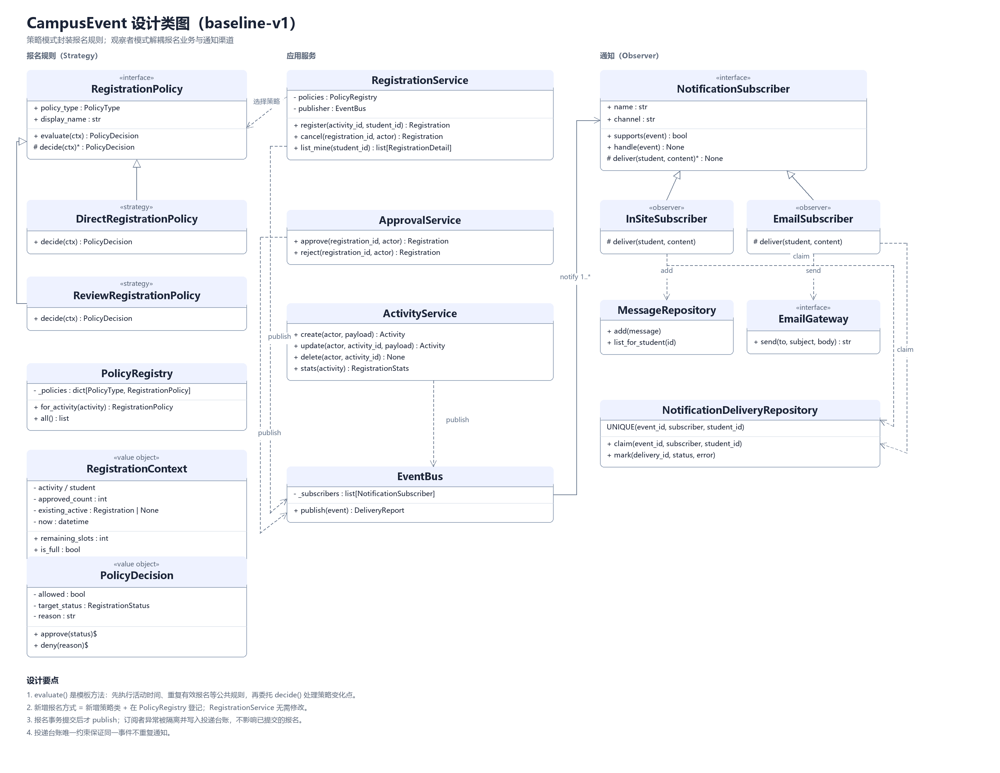
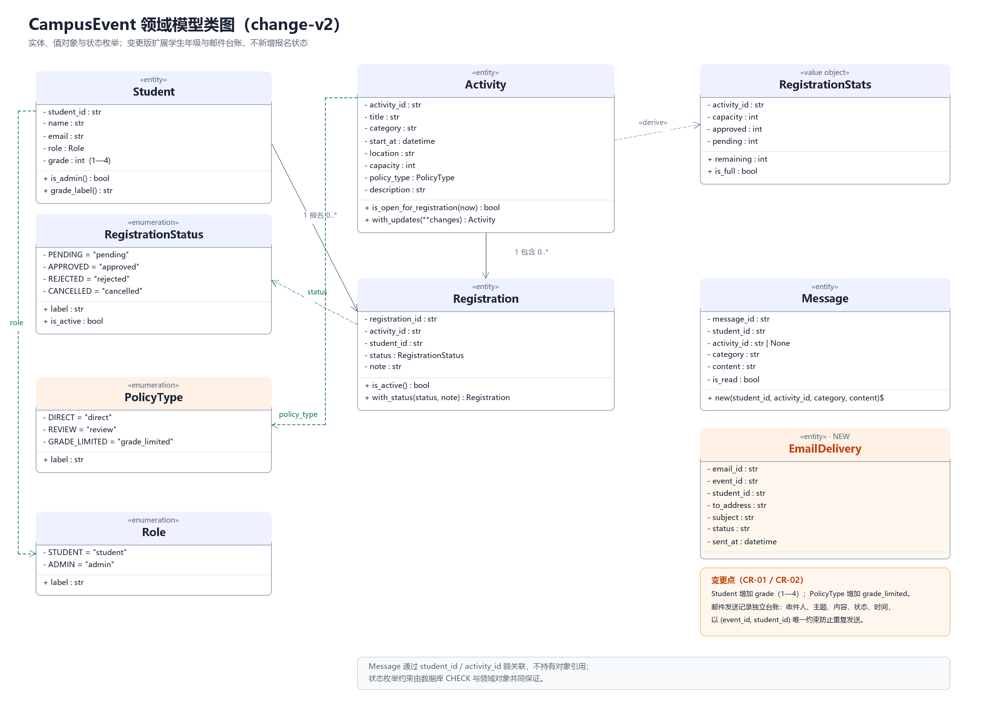
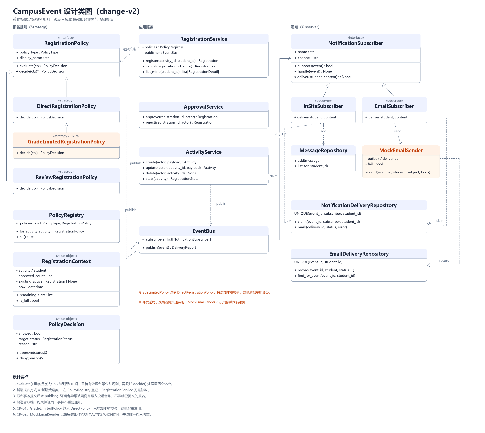

# UML 类图与职责划分（baseline-v1 / change-v2）

本文件同时给出**初版**与**变更版**的类图，共四张：领域模型视角回答“系统有哪些业务概念、它们如何关联”，设计类图视角回答“职责如何分配到类/接口、变化点被隔离在哪里”。变更版图中橙色元素为教师变更单 CR-01 / CR-02 引入的新增或修改点。

| 视图 | 初版（baseline-v1） | 变更版（change-v2） |
| --- | --- | --- |
| 领域模型类图 | `images/class_domain_baseline.png` | `images/class_domain_change.png` |
| 设计类图 | `images/class_design_baseline.png` | `images/class_design_change.png` |

---

# 第一部分：初版（baseline-v1）

## 1. 领域模型类图


### 1.1 实体与值对象

| 对象 | 类型 | 主要字段 | 约束/不变量 |
| --- | --- | --- | --- |
| Student | 实体 | student_id、name、email、role | student_id 唯一；role 限 student/admin |
| Activity | 实体 | activity_id、title、category、start_at、location、capacity、policy_type | capacity 1—500；开始前才可报名 |
| Registration | 实体 | registration_id、activity_id、student_id、status、note | 状态限四值；同一学生同一活动最多一条 pending/approved |
| Message | 实体 | message_id、student_id、activity_id、category、content、is_read | 站内消息按学生查询；activity_id 允许为空 |
| RegistrationStats | 值对象 | capacity、approved、pending | remaining = max(capacity-approved, 0)；is_full |
| RegistrationStatus / PolicyType / Role | 枚举 | 固定取值 | 与数据库 CHECK 约束一致 |

### 1.2 关系与数量

- `Student 1 — 0..* Registration`：一个学生可有多条报名，分属不同活动；同一活动最多一条有效报名（由部分唯一索引约束）。
- `Activity 1 — 0..* Registration`：活动包含报名；删除活动采用拒绝策略，避免破坏该组合关系。
- `Registration ..> RegistrationStatus`、`Activity ..> PolicyType`、`Student ..> Role`：枚举作为状态/类型的受限取值。
- `Activity ..> RegistrationStats`：统计是查询派生结果，不持久化，避免日期/状态变化后统计失真。
- `Message` 通过 `student_id`、`activity_id` 弱关联，不持有实体引用：消息是历史快照，不应因活动修改而改变内容。

### 1.3 边界情况

- 报名记录不做物理删除，取消/拒绝保留历史（B.2 第 4 条）。
- 状态字符串与枚举值一一对应，避免中文展示值进入数据库。
- 活动容量与报名数之间没有数据库触发器，容量约束由服务层在事务内保证。

## 2. 设计类图



### 2.1 分层与依赖方向

```
web 蓝图（Flask）
   ↓ 只依赖
services（编排、事务、事件发布）
   ↓ 依赖抽象               ↘ 发布事件
domain（模型 / 策略 / 事件）      EventBus → NotificationSubscriber → 仓储/邮件网关
   ↑
repositories（SQLite 实现，被容器注入服务）
```

- `domain/` 不导入 Flask、sqlite3、requests，可直接单元测试。
- `web/` 不直接操作 SQL；所有业务动作经服务。
- 服务依赖 `PolicyRegistry` 与 `EventBus` 抽象，而非某个具体策略或渠道。
- 仓储实现被 `container.py` 注入；测试可替换邮件发送器为故障注入实现。

### 2.2 关键类职责

| 类/接口 | 职责 | 不负责 |
| --- | --- | --- |
| `RegistrationPolicy` | 模板方法：公共校验 + 委托 `decide` | 写库、发通知、选择自己 |
| `DirectRegistrationPolicy` | 有名额→APPROVED；满员→拒绝 | 重复报名、活动时间（父类处理） |
| `ReviewRegistrationPolicy` | 一律→PENDING | 容量复核（审批服务处理） |
| `PolicyRegistry` | 按 `policy_type` 查找策略 | 业务判断 |
| `RegistrationContext` / `PolicyDecision` | 一次判定的输入/输出值对象 | 持久化 |
| `RegistrationService` | 选择策略、事务内报名/取消、提交后发事件 | 消息文案、页面渲染 |
| `ApprovalService` | 审批状态流转、批准前容量复核 | 报名创建 |
| `ActivityService` | 活动 CRUD、字段校验、删除保护、统计查询 | 报名状态变更 |
| `EventBus` | 分发事件、隔离订阅者异常 | 业务规则、数据库事务 |
| `NotificationSubscriber` | 幂等 claim、逐人投递、记录成功/失败 | 修改报名 |
| `NotificationDeliveryRepository` | 投递台账与唯一约束 | 文案生成 |

### 2.3 策略模式结构

- 抽象：`RegistrationPolicy.evaluate()` 是 **模板方法**，固定“公共规则→策略判定”的顺序。
- 实现：`DirectRegistrationPolicy`、`ReviewRegistrationPolicy`。
- 上下文：`RegistrationService` 持有 `PolicyRegistry`，运行时按活动的 `policy_type` 取策略。
- 客户端：不出现 `if activity.policy_type == ...` 的分支；新增策略只需注册。

### 2.4 观察者模式结构

- 主题：`EventBus`，维护订阅者列表，`publish(event)`。
- 观察者：`InSiteNotificationSubscriber`、`EmailNotificationSubscriber`，均实现 `handle(event)`。
- 事件：`RegistrationSubmitted / Approved / Rejected / Cancelled`，携带渲染所需的实体快照。
- 事务边界：服务先提交报名事务，再 `publish`；订阅者异常被 `EventBus` 捕获，写入投递台账。
- 幂等：`notification_deliveries` 唯一约束 `(event_id, subscriber, student_id)`。

---

# 第二部分：变更版（change-v2）

变更单见 `07_变更需求单与影响分析.md`。两项变更来自教师材料：

- **CR-01 年级限定报名**：Student 增加 grade（1—4），新增“年级限定直接报名”，仅大二、大三可报名；
- **CR-02 模拟邮件通知**：报名通过 / 审核通过或拒绝时，站内通知继续运行，同时由 MockEmailSender 记录邮件（收件人、主题、内容、状态、时间），失败只留痕、不重复发送。

## 3. 变更版领域模型类图



### 3.1 变更点清单

| 元素 | 变更类型 | 变更内容 | 影响 |
| --- | --- | --- | --- |
| `Student.grade` | 新增字段 | 取值 1—4（大一至大四），构造时校验 | 年级限定策略的唯一新增输入 |
| `Student.grade_label` | 新增属性 | 返回“大一/大二/大三/大四” | 拒绝提示可读性 |
| `PolicyType` | 新增枚举值 | `GRADE_LIMITED = "grade_limited"` | 第三种报名方式；数据库 CHECK 扩展 |
| `EmailDelivery` | 新增实体（审计） | email_id、event_id、student_id、to_address、subject、status、sent_at | CR-02 的邮件发送记录，不是报名实体 |
| `Activity` / `Registration` / `RegistrationStatus` | 不变 | — | 原有直接报名、审核报名行为不受影响 |

### 3.2 不变量

1. **年级合法**：`grade ∈ {1,2,3,4}`，数据库 CHECK 与 `Student.__post_init__` 双重保证。
2. **年级限定准入**：仅 `grade ∈ {2,3}` 可报名 `grade_limited` 活动；其他年级收到明确原因，且不产生报名记录。
3. **公共约束不变**：活动必须未开始、同一学生同一活动最多一条有效报名、名额只统计已通过；年级策略同样受这些约束。
4. **邮件幂等**：`email_deliveries` 以 `(event_id, student_id)` 唯一，同一业务事件对同一学生只发送一封。
5. **失败不影响业务**：邮件发送失败只写 `status=failed` 与错误，不回滚已提交的报名。

### 3.3 关系与边界

- `Student 1 — 0..* EmailDelivery`：邮件记录按学生弱关联；即使学生或活动信息变化，历史邮件内容仍保留快照。
- `EmailDelivery ..> 事件`：通过 `event_id` 关联领域事件，用于幂等与审计，不反向依赖报名服务。
- 年级限定活动与普通活动共用 Activity 结构，没有新增活动子类；差异只体现在 `policy_type` 与对应策略。

## 4. 变更版设计类图



### 4.1 新增与修改的类

| 元素 | 变更类型 | 职责 | 说明 |
| --- | --- | --- | --- |
| `GradeLimitedRegistrationPolicy` | 新增类 | 先校验年级 ∈ {2,3}，再复用直接报名的容量判定 | **继承** `DirectRegistrationPolicy`，只覆写 `decide` |
| `MockEmailSender` | 新增类 | `send(event_id, student, subject, body)`：写 `email_outbox` 与 `email_deliveries`，失败抛 `NotificationError` | 教师要求的 MockEmailSender；渠道实现，不反向依赖业务服务 |
| `EmailReceipt` | 新增值对象 | 发送结果（transport_id、status、duplicate） | 便于测试与调用方判断重复 |
| `EmailDeliveryRepository` | 新增仓储 | 邮件台账 record / find_for_event / list_recent / count_by_status | 唯一约束 `(event_id, student_id)` |
| `EmailNotificationSubscriber` | 修改 | 改为调用 `MockEmailSender`，并把 `event_id` 带入发送 | 订阅者模板、站内订阅者不变 |
| `NotificationContent` | 修改 | 增加 `event_id`，供邮件幂等使用 | 文案构建器统一填充 |
| `email.py`（旧出件箱网关） | 删除 | 由 `mock_email.py` 取代 | 净类数 +1（新增 4、删除 3） |
| `migrations.py` | 修改 | v1→v2：students 增 grade、activities 扩展 CHECK、新增 email_deliveries | 保留既有数据 |
| `seed.py` / 页面 | 修改 | 演示年级、三种报名方式、邮件台账展示 | 与需求一致 |

### 4.2 CR-01：为什么用“继承直接报名”的策略

`GradeLimitedRegistrationPolicy` 的设计有两种写法：

1. 直接继承 `RegistrationPolicy`，重新实现年级与容量两段逻辑；
2. 继承 `DirectRegistrationPolicy`，只增加年级判定，然后调用 `super().decide(ctx)` 复用容量逻辑。

本项目选择 **2**，理由：

- “年级限定”在业务上就是“直接报名 + 年级门槛”，容量、满员行为完全相同；继承避免重复实现容量规则，符合 DRY；
- 公共规则（活动时间、重复报名）仍在 `RegistrationPolicy.evaluate()` 模板方法中，不会被绕过；
- `RegistrationService.register()` 仍然没有 `policy_type` 分支，新增方式只需在 `PolicyRegistry` 注册。

这是“按原系统设计决定”的具体体现：原系统的 `decide` 变化点足以承载年级判断，不需要引入可组合规则框架。

### 4.3 CR-02：MockEmailSender 在观察者结构中的位置

```
RegistrationService ──publish──▶ EventBus
                                  ├─ InSiteNotificationSubscriber ──▶ messages
                                  └─ EmailNotificationSubscriber ──▶ MockEmailSender
                                                                       ├─ email_outbox
                                                                       └─ email_deliveries（状态/错误/时间）
```

- 邮件发送属于**渠道副作用**，因此放在订阅者侧，不进入 `RegistrationService`；
- `MockEmailSender` 只依赖仓储与时钟，不依赖业务服务，避免反向依赖；
- 订阅者模板负责幂等 claim 与失败隔离；`MockEmailSender` 再以 `(event_id, student_id)` 做邮件级幂等，双保险；
- 失败时 `MockEmailSender` 记录 failed + error 后抛错，订阅者把投递台账标为 failed，业务事务已提交，不回滚。

### 4.4 依赖方向有没有变坏

没有。变更只**向下**使用既有抽象：

- `GradeLimitedRegistrationPolicy` 依赖领域值对象与父类策略；
- `MockEmailSender` 依赖 `EmailOutboxRepository`、`EmailDeliveryRepository`、`Clock`；
- `EmailNotificationSubscriber` 依赖 `MockEmailSender`，而 `EventBus` 只认识订阅者接口；
- `domain/` 仍然不导入 Flask/sqlite3，`web/` 仍然不直接写 SQL。

### 4.5 变更后的 SOLID 对照

| 原则 | 初版体现 | 变更阶段的验证 |
| --- | --- | --- |
| SRP | 策略只判定、服务只编排、订阅者只投递 | 年级判断在策略；邮件记录在 MockEmailSender；台账在仓储 |
| OCP | 新增报名方式通过新增策略 | CR-01 只新增 1 个策略类 + 注册 1 行，`RegistrationService` 零改动 |
| LSP | 两个策略共用 `evaluate` 契约 | `GradeLimitedPolicy` 是 `DirectPolicy` 的子类型，可被注册表无差别调用 |
| ISP | `EmailGateway` 只暴露 `send` | `MockEmailSender` 只暴露 `send`；订阅者接口未扩大 |
| DIP | 服务依赖注册表/事件总线抽象 | 发送器依赖仓储与时钟，容器装配 |

## 5. 两版类图差异汇总

| 维度 | baseline-v1 | change-v2 | 差值 |
| --- | --- | --- | --- |
| 实体类 | 5 | 6（新增 EmailDelivery 审计实体） | +1 |
| 报名策略实现 | 2 | 3 | +1 |
| 应用服务 | 3 | 3 | 0 |
| 领域事件 | 4 | 4 | 0 |
| Python 类定义总数 | 52 | 53 | 净 +1（新增 4、删除 3 个旧邮件网关类） |
| Python 文件数 / 源码行数 | 25 / 2497 | 25 / 2778 | 0 / +281 |
| 测试用例数 | 29 | 41 | +12 |

> 口径：`app/**/*.py`（含 docstring 与类型注解），由 `docs/tools/metrics.py` 与 `git diff --stat baseline-v1..change-v2` 统计；不含测试与文档。

## 6. 设计成本（如实记录）

- 类数量与调用链略有增加：源码 +281 行，邮件台账与发送器新增 4 个类，删除旧的 3 个网关类。
- 一次报名仍要经过 controller → service → policy → repository → event bus → 2 个订阅者 → 发送器；排错需要同时看业务表与两张台账。
- 对小项目存在过度设计风险；本项目的理由是“需求明确要求可扩展的报名规则与多通知渠道”，而变更阶段确实只新增 1 个策略类就接入了第三种报名方式，收益可被度量。

## 7. 代码映射

| 设计元素 | 文件 |
| --- | --- |
| 实体/枚举/值对象（含 grade） | `app/domain/models.py` |
| 策略与注册表（3 个策略） | `app/domain/policies.py` |
| 领域事件 | `app/domain/events.py` |
| 事件总线 | `app/services/event_bus.py` |
| 通知订阅者与文案 | `app/services/notification_service.py` |
| MockEmailSender | `app/services/mock_email.py` |
| 报名/审批/活动服务 | `app/services/*.py` |
| 仓储（含邮件台账） | `app/repositories.py` |
| 装配 | `app/container.py`、`app/dependencies.py` |
| 表结构与迁移（v1→v2） | `app/migrations.py` |
| 变更影响与实测数据 | `07_变更需求单与影响分析.md`、`09_可维护性对照.md` |
