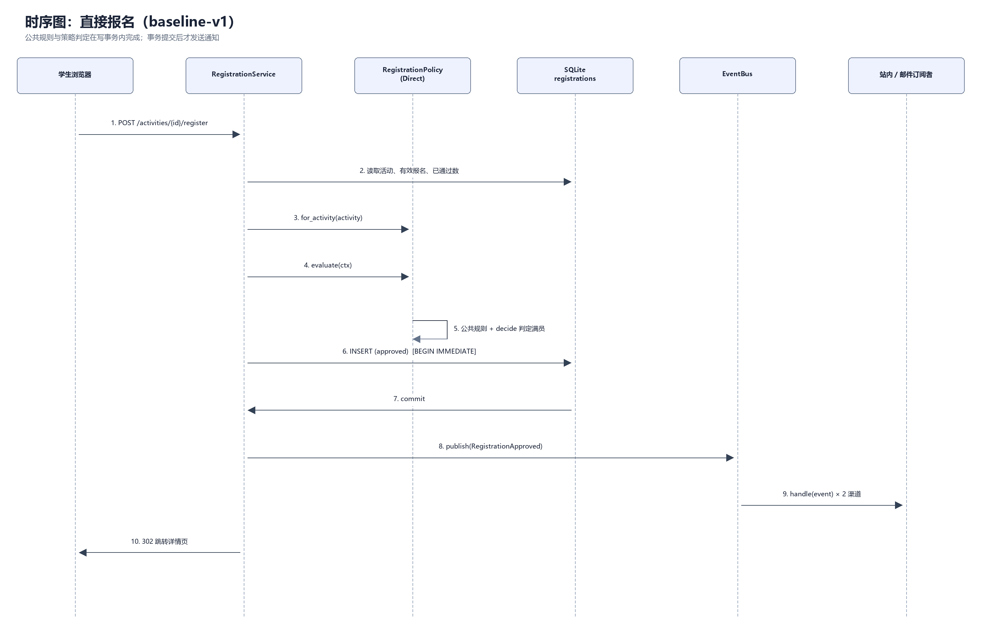
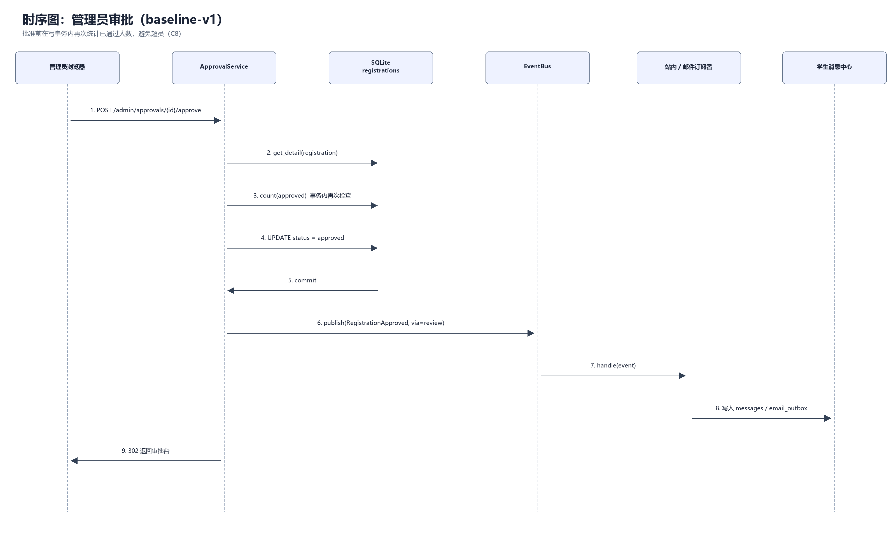

# 关键交互时序图（baseline-v1）

时序图按“直接报名”“审核型报名”“审批”三条主路径描述。图中每一步都能在代码中找到对应调用；事务边界与通知时点是设计重点。

## 1. 直接报名



流程说明：

1. 浏览器提交 `POST /activities/{id}/register`，Web 层只取当前登录用户，不拼业务参数。
2. `RegistrationService` 读取活动、学生、该学生的有效报名与已通过人数，构造 `RegistrationContext`。
3. `PolicyRegistry.for_activity()` 按活动 `policy_type` 选择 `DirectRegistrationPolicy`。
4. `evaluate()` 先执行公共规则：活动是否开始、是否存在重复有效报名；随后 `decide()` 判断名额。
5. 有名额则目标状态为 `APPROVED`；满员则返回拒绝原因，服务抛出 `RegistrationRejected`。
6. 插入报名与计数在同一 `BEGIN IMMEDIATE` 事务内，避免两个请求同时看到最后一个名额。
7. 事务提交后发布 `RegistrationApproved(via=direct)`，通知失败不会回滚报名。
8. 两个订阅者分别投递站内消息与邮件，逐人 claim 台账、记录成功/失败。

对应验收：C2（直接通过 + 通知）、C3（重复报名）、C4（满员拒绝）。

## 2. 审核型报名


与原流程的差异：

- `ReviewRegistrationPolicy.decide()` 不检查当前是否满员，固定返回 `PENDING`；待审核不占用名额。
- 事件类型为 `RegistrationSubmitted`，通知文案说明“待审核”。
- 页面提示“报名申请已提交”，统计中已通过数不变、待审核数加一。

这样处理的原因：若在提交阶段因满员拒绝审核型报名，就剥夺了“候补/待审批”的业务空间，也与 B.2 第 2、3 条冲突。真正的容量闸门放在审批。

## 3. 管理员审批



审批的关键点：

1. 只有 `PENDING` 状态可以审批；已通过/已拒绝/已取消都会拒绝操作。
2. 批准前在写事务内重新统计已通过人数，`approved >= capacity` 时抛出 `CapacityExceeded`，报名保持待审核。
3. 状态更新与容量复核处于同一事务，避免“检查通过后、写入前被其他报名抢占名额”。
4. 提交后发布 `RegistrationApproved(via=review)`，通知与直接报名复用同一套订阅者，无需新增通知代码。

对应验收：C6（批准并通知）、C7（拒绝并通知）、C8（满员批准失败且不超员）。

## 4. 通知与事务边界

```
RegistrationService
  ├─ BEGIN IMMEDIATE
  │    ├─ 业务校验（策略）
  │    ├─ INSERT/UPDATE registrations
  │    └─ COMMIT                    ← 业务事实已持久化
  └─ EventBus.publish(event)        ← 仍在同一请求内，但不在同一事务
       ├─ InSiteSubscriber.handle() → claim → INSERT messages → mark(sent)
       └─ EmailSubscriber.handle()   → claim → gateway.send() → mark(sent/failed)
```

设计取舍：

- **不把通知放进业务事务**：邮件网关是外部副作用，若在同一事务内失败会导致报名回滚；需求明确“通知失败不得让已合法提交的报名无声消失”。
- **失败可观测**：每个渠道、每个学生一条 `notification_deliveries` 记录，失败保留错误信息；管理员通知台账可查。
- **重复通知防护**：同一 `event_id + subscriber + student_id` 只能 claim 一次；重复发布同一事件时第二个订阅者调用被跳过。
- **顺序保证**：先提交、后发布，因此订阅者回查数据库时一定能看到已提交的报名。

## 5. 错误路径对照

| 场景 | 触发点 | 事务结果 | 用户可见结果 |
| --- | --- | --- | --- |
| 重复报名 | `evaluate` 公共规则 | 未开事务/回滚 | “你已有一条第 X 的报名，不能重复报名” |
| 直接报名满员 | `DirectRegistrationPolicy.decide` | 回滚 | “名额已满（上限 N 人），报名失败” |
| 活动已开始 | `evaluate` 公共规则 | 回滚 | “活动已开始，不能再报名” |
| 审批满员 | `ApprovalService.approve` | 回滚 | “名额已满……无法批准”，状态仍待审核 |
| 邮件失败 | `EmailSubscriber.deliver` | 已提交，不回滚 | 报名成功；台账显示邮件失败原因 |
| 重复事件 | `delivery.claim` | 不重复写 | 不产生第二条消息/邮件 |
