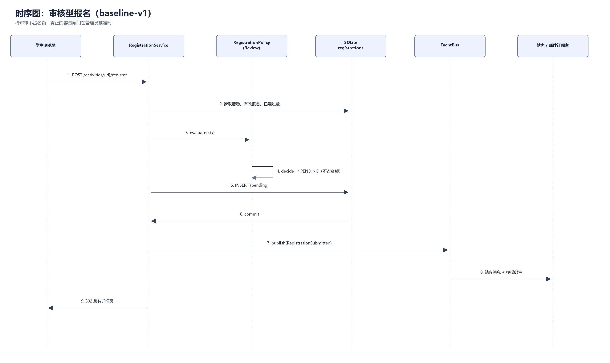
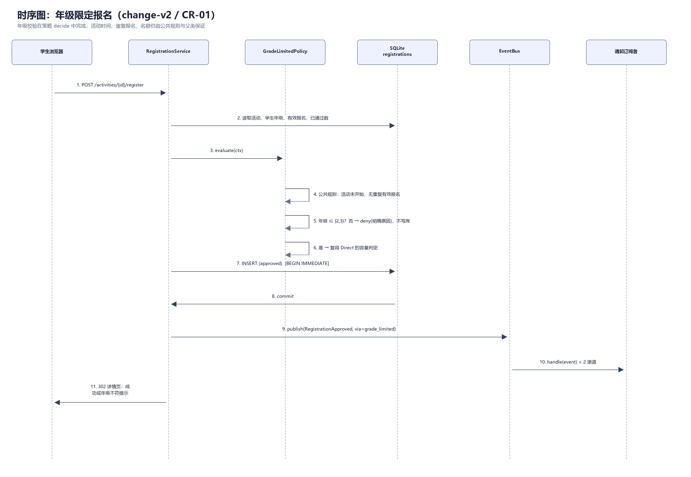
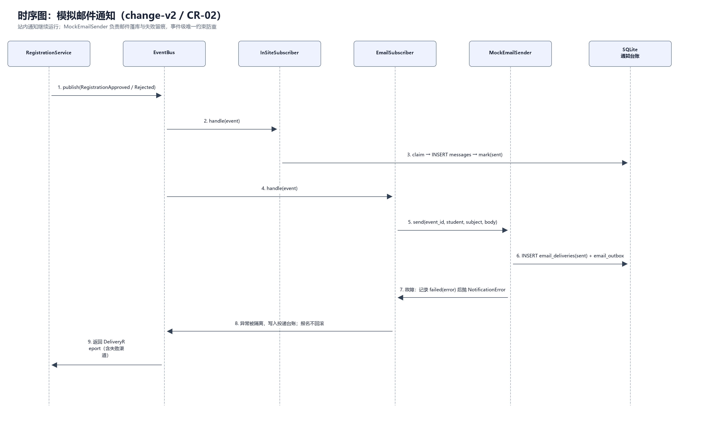

# 关键交互时序图（baseline-v1 / change-v2）

时序图按“直接报名”“审核型报名”“审批”“年级限定报名”“模拟邮件通知”五条主路径描述。图中每一步都能在代码中找到对应调用；事务边界与通知时点是设计重点。前三条属于初版，后两条是 change-v2 的 CR-01 / CR-02。

## 1. 直接报名（baseline-v1）


流程说明：

1. 浏览器提交 `POST /activities/{id}/register`，Web 层只取当前登录用户，不拼业务参数。
2. `RegistrationService` 读取活动、学生、该学生的有效报名与已通过人数，构造 `RegistrationContext`。
3. `PolicyRegistry.for_activity()` 按活动 `policy_type` 选择 `DirectRegistrationPolicy`。
4. `evaluate()` 先执行公共规则：活动是否开始、是否存在重复有效报名；随后 `decide()` 判断名额。
5. 有名额则目标状态为 `APPROVED`；满员则返回拒绝原因，服务抛出 `RegistrationRejected`。
6. 插入报名与计数在同一 `BEGIN IMMEDIATE` 事务内，避免两个请求同时看到最后一个名额。
7. 事务提交后发布 `RegistrationApproved(via=direct)`，通知失败不会回滚报名。
8. 两个订阅者分别投递站内消息与邮件，逐人 claim 台账、记录成功/失败。

对应验收：C2（直接通过 + 通知）、C3（重复报名）、C4（满员拒绝）。

## 2. 审核型报名（baseline-v1）



与原流程的差异：

- `ReviewRegistrationPolicy.decide()` 不检查当前是否满员，固定返回 `PENDING`；待审核不占用名额。
- 事件类型为 `RegistrationSubmitted`，通知文案说明“待审核”。
- 页面提示“报名申请已提交”，统计中已通过数不变、待审核数加一。

这样处理的原因：若在提交阶段因满员拒绝审核型报名，就剥夺了“待审批”的业务空间，也与 B.2 第 2、3 条冲突。真正的容量闸门放在审批。

## 3. 管理员审批（baseline-v1）


审批的关键点：

1. 只有 `PENDING` 状态可以审批；已通过/已拒绝/已取消都会拒绝操作。
2. 批准前在写事务内重新统计已通过人数，`approved >= capacity` 时抛出 `CapacityExceeded`，报名保持待审核。
3. 状态更新与容量复核处于同一事务，避免“检查通过后、写入前被其他报名抢占名额”。
4. 提交后发布 `RegistrationApproved(via=review)`，通知与直接报名复用同一套订阅者，无需新增通知代码。

对应验收：C6（批准并通知）、C7（拒绝并通知）、C8（满员批准失败且不超员）。

## 4. 年级限定报名（change-v2 / CR-01）



关键点：

1. 活动 `policy_type=grade_limited`，`PolicyRegistry` 选择 `GradeLimitedRegistrationPolicy`。
2. 模板方法 `evaluate()` 仍先执行公共规则：活动未开始、无重复有效报名；这一步与直接报名完全相同。
3. `decide()` 先读 `RegistrationContext.student.grade`：不在 `{2,3}` 时返回 `deny("该活动仅限大二、大三学生报名（你的年级：大一/大四）")`；服务抛出 `RegistrationRejected`，**不写报名记录**。
4. 年级符合时调用 `super().decide(ctx)`，复用 `DirectRegistrationPolicy` 的容量判定：有名额→`APPROVED`，满员→拒绝。
5. 通过后在同一套事务与事件机制中完成落库、发布与双渠道通知，没有新增服务流程。

对应验收：CR1-01（大二通过）、CR1-02（大三通过）、CR1-03（大一拒绝）、CR1-04（大四拒绝）、C4/C3 的容量与重复约束回归。

## 5. 模拟邮件通知（change-v2 / CR-02）



关键点：

1. 报名/审批事务提交后，`RegistrationService` 或 `ApprovalService` 发布 `RegistrationApproved / Rejected` 等事件。
2. `InSiteNotificationSubscriber` 继续写 `messages`，原有站内通知不变。
3. `EmailNotificationSubscriber` 调用 `MockEmailSender.send(event_id, student, subject, body)`。
4. 发送成功：写入 `email_outbox`（模拟邮箱）与 `email_deliveries`（收件人、主题、内容、`status=sent`、`sent_at`、传输编号）。
5. 发送失败：`MockEmailSender` 写入 `email_deliveries(status=failed, error=...)` 后抛出 `NotificationError`；订阅者把 `notification_deliveries` 标为 failed，业务事务已提交，不回滚。
6. 幂等：订阅者以 `(event_id, subscriber, student_id)` claim，`MockEmailSender` 再以 `(event_id, student_id)` 唯一约束拦截；重复发布不会产生第二封邮件。

对应验收：CR2-01（直接通过双渠道）、CR2-02（审核通过/拒绝双渠道）、CR2-03（邮件失败不回滚且留痕）、CR2-04（重复事件不重复发送）。

## 6. 通知与事务边界

```
RegistrationService / ApprovalService
  ├─ BEGIN IMMEDIATE
  │    ├─ 业务校验（策略 / 审批容量）
  │    ├─ INSERT/UPDATE registrations
  │    └─ COMMIT                    ← 业务事实已持久化
  └─ EventBus.publish(event)        ← 仍在同一请求内，但不在同一事务
       ├─ InSiteSubscriber.handle() → claim → INSERT messages → mark(sent)
       └─ EmailSubscriber.handle()  → claim → MockEmailSender.send()
                                              ├─ INSERT email_outbox
                                              └─ INSERT email_deliveries(sent/failed)
```

设计取舍：

- **不把通知放进业务事务**：邮件发送是外部副作用，若在同一事务内失败会导致报名回滚；需求明确“邮件发送故障不得错误回滚已成功提交的报名”。
- **失败可观测**：`notification_deliveries` 记录渠道级状态与错误，`email_deliveries` 记录每封邮件的状态、错误与时间；管理员通知台账可查。
- **重复通知防护**：订阅者层面 `(event_id, subscriber, student_id)` 唯一；邮件层面再以 `(event_id, student_id)` 唯一，双重防重。
- **顺序保证**：先提交、后发布，因此订阅者回查数据库时一定能看到已提交的报名。

## 7. 错误路径对照

| 场景 | 触发点 | 事务结果 | 用户可见结果 |
| --- | --- | --- | --- |
| 重复报名 | `evaluate` 公共规则 | 未开事务/回滚 | “你已有一条第 X 的报名，不能重复报名” |
| 直接报名满员 | `DirectRegistrationPolicy.decide` | 回滚 | “名额已满（上限 N 人），报名失败” |
| 活动已开始 | `evaluate` 公共规则 | 回滚 | “活动已开始，不能再报名” |
| 年级不符 | `GradeLimitedPolicy.decide` | 未开事务/回滚 | “该活动仅限大二、大三学生报名（你的年级：大一/大四）” |
| 年级符合但满员 | `GradeLimitedPolicy` 复用父类判定 | 回滚 | “名额已满（上限 N 人），报名失败” |
| 审批满员 | `ApprovalService.approve` | 回滚 | “名额已满……无法批准”，状态仍待审核 |
| 邮件失败 | `MockEmailSender.send` | 已提交，不回滚 | 报名成功；`email_deliveries` 与投递台账记录失败原因 |
| 重复事件 | `delivery.claim` / `email_deliveries` 唯一约束 | 不重复写 | 不产生第二条消息或第二封邮件 |
